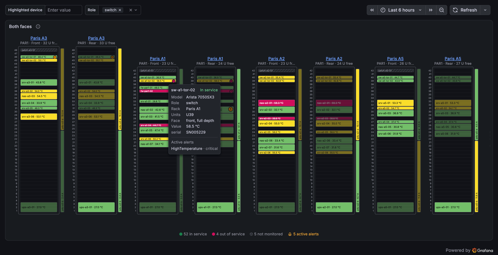

# Rack elevation panel for Grafana

[](https://github.com/Kentrow/grafana-rackelevation-panel/actions/workflows/ci.yml)
[](https://grafana.com/docs/grafana/latest/)
[](LICENSE)

Front and rear views of your racks, unit by unit, placed from your inventory data (NetBox, Nautobot, SQL, CSV...) and
coloured by device state or by any metric with the standard Grafana field config.



**[User documentation](src/README.md)**: quick start, data contract, colours, interactions and recipes for CSV,
NetBox and Prometheus. It is also the page of the plugin in the Grafana catalog.

## Try it locally

Requirements: Node.js 22 or later, and Docker.

```bash
npm install
npm run build
docker compose up
```

Then open <http://localhost:3000> (anonymous access, no login) and the dashboards tagged `rack-elevation`:

- **Rack elevation demo**: front view, both faces with alerts, role filter, temperature thresholds, data links on the
  devices and the racks. Add `?var-device=sw-hq-core-01` to the URL to highlight a device.
- **Rack elevation fixtures**: one panel per reference data set: faces, descending numbering, 0U band, overlaps and
  overflows, child devices, 10-inch rack, 30 racks of 1000 devices, Prometheus frames.
- **Rack elevation live (Prometheus)**: the PromQL recipes on live metrics from a small exporter, with alerts firing
  now and then.

Everything comes from TestData and from the Prometheus and exporter containers of `docker-compose.yaml`: no account,
no external service.

## Feedback and contributing

Bugs and ideas are welcome in the [issues](https://github.com/Kentrow/grafana-rackelevation-panel/issues). To work on
the code, see [CONTRIBUTING.md](CONTRIBUTING.md).

## License

[Apache 2.0](LICENSE)
