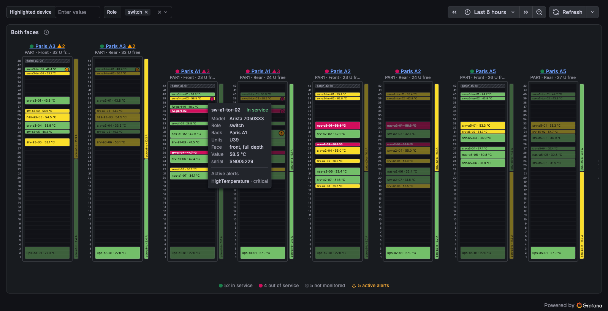
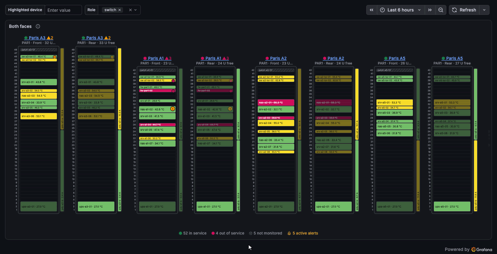

# Rack elevation panel

[](https://grafana.com/grafana/plugins/kentrow-rackelevation-panel/)
[](https://grafana.com/grafana/plugins/kentrow-rackelevation-panel/)
[](https://github.com/Kentrow/grafana-rackelevation-panel/actions/workflows/ci.yml)
[](https://grafana.com/docs/grafana/latest/)
[](https://github.com/Kentrow/grafana-rackelevation-panel/blob/main/LICENSE)

Front and rear views of your racks, unit by unit, drawn from your inventory data and coloured by device state or by
any metric.



The placement comes from the data: when the inventory changes (NetBox, Nautobot, a CMDB, a SQL table, a CSV file),
the view changes. The panel knows no data source; it reads tables with documented columns, so anything that can
produce such a table works without extra code.

- One or several racks side by side, front, rear or both faces, 10-inch or 19-inch, sized to fill the panel.
- Where a new device fits: the free blocks of each rack for a given height.
- Power draw of each rack against its capacity, with a gauge.
- NetBox placement rules: lowest unit, descending numbering, full-depth devices, 0U devices.
- Colour, unit, value mappings, data links and variables come from the standard Grafana field config.
- In service, out of service and not monitored states; active alerts badge; the worst state, alerts and free units
  of each rack; a legend with the counts.
- Labels from a template of any columns; a device card on hover with the columns you pick; data links on click.
- Highlight of devices from a dashboard variable (wildcards allowed), role filter, keyboard navigation.
- Overlapping or overflowing devices are drawn and listed, never hidden.



## Installation

Grafana 13.2 or later. In Grafana, open **Administration > Plugins and data > Plugins**, search for **Rack
elevation** and install it, or run:

```bash
grafana cli plugins install kentrow-rackelevation-panel
```

## Quick start

Display a rack in a few minutes, with no data source to install:

1. Create a dashboard and add a visualization with the **TestData** data source.
2. Set **Scenario** to **CSV Content** and paste:

   ```csv
   device,rack,position,u_height,face,is_full_depth,role,model,status,value
   patch-hq-01,RACK-HQ-01,42,1,front,false,patch-panel,Panduit CP48,,
   fw-hq-01,RACK-HQ-01,40,1,front,true,firewall,FortiGate 100F,up,41
   sw-hq-core-01,RACK-HQ-01,38,1,front,true,switch,Cisco C9300-48P,up,45
   sw-hq-core-02,RACK-HQ-01,37,1,front,true,switch,Cisco C9300-48P,up,47
   wlc-hq-01,RACK-HQ-01,35,1,front,true,wireless,Aruba 7210,up,62
   wlc-hq-02,RACK-HQ-01,34,1,front,true,wireless,Aruba 7210,down,
   nas-hq-01,RACK-HQ-01,24,2,front,true,storage,Synology RS1221+,up,36
   srv-hq-01,RACK-HQ-01,20,2,front,true,server,Dell R760,up,38
   ups-hq-01,RACK-HQ-01,1,3,rear,true,ups,APC SRT3000,up,29
   pdu-hq-a,RACK-HQ-01,,0,rear,false,pdu,APC AP8853,,
   ```

3. Pick the **Rack elevation** visualization.
4. In **Standard options**, set the unit to **Celsius**; in **Thresholds**, add a step at 50 (yellow) and one at 60
   (red). The devices take the colour of their temperature.

## Data contract

The panel reads table frames: one row per device, one column per attribute. Columns are found by their default names,
ignoring case, or mapped to other names in the **Columns** options.

### Devices (required)

| Column          | Type             | Required | Meaning                                                                       |
| --------------- | ---------------- | -------- | ----------------------------------------------------------------------------- |
| `device`        | string           | yes      | Unique device name, the key of the alerts frame and of the highlight variable |
| `rack`          | string           | yes      | Rack of the device                                                            |
| `position`      | number           | no       | Lowest-numbered unit occupied, as in NetBox. Empty for a 0U device            |
| `u_height`      | number           | no       | Height in units, 1 by default                                                 |
| `face`          | string           | no       | `front` or `rear`, `front` by default                                         |
| `is_full_depth` | boolean          | no       | Seen from both faces, `true` by default                                       |
| `role`          | string           | no       | Used by the role filter, the label and the card                               |
| `model`         | string           | no       | Shown in the card and the label                                               |
| `status`        | string or number | no       | In service when it is one of the **In service values**; empty: not monitored  |
| `value`         | number           | no       | Metric giving the colour, see [Colours](#colours)                             |
| `parent_device` | string           | no       | The row is listed in the card of its parent instead of being placed           |
| `power`         | number           | no       | Power draw in watts, added up per rack, see [Power](#power)                   |

Any other column is shown in the device card, as it is: site, serial number, IP address... Pick some of them, in the
order you want, with **Card columns**.

When the frame has a time field, as with a Prometheus range query, only the latest row of each device is read.

### Racks (optional)

| Column           | Type    | Meaning                                                 |
| ---------------- | ------- | ------------------------------------------------------- |
| `rack`           | string  | Rack, the key of the `rack` column of the devices       |
| `name`           | string  | Name shown above the rack, `rack` by default            |
| `u_height`       | number  | Height in units, 42 by default                          |
| `starting_unit`  | number  | Number of the first unit, 1 by default                  |
| `desc_units`     | boolean | Units numbered from the top, `false` by default         |
| `site`           | string  | Shown under the name                                    |
| `width`          | number  | Width in inches as in NetBox (10, 19...), 19 by default |
| `power_capacity` | number  | Power the rack can deliver, in watts                    |

Without a racks frame, each rack of the devices is drawn with these defaults and grows to fit its highest device.
With a racks frame, devices outside the rack are drawn in a dashed overflow zone and listed as problems. The racks
are drawn in the order of the **Racks** option, then of the racks frame, then of the devices. When the **Racks**
option lists racks, by id or name and with variables if needed, only those are drawn.

### Alerts (optional)

A frame with a `device` column and an `alertname` column, and optionally `severity`. Each row is an active alert:
the device gets a badge with their count, red if one is `critical`, and the card lists them.

### Which frame is which

The frames can be picked in the **Data** options, by query or frame name. Otherwise the devices frame is the one with
`device` and `position` or `u_height` columns, the racks frame the one with `rack` and no `device`, the alerts frame
the one with `alertname`.

The panel does not join frames itself. Several queries that return device columns (an inventory and two metrics, for
instance) must be joined with the **Join by field** transformation, mode **OUTER (TABULAR)**, on `device`. The panel
lists the frames it ignores.

## Placement

The rules follow NetBox, so that the view matches the rack page of NetBox or Nautobot:

- A device occupies the units from `position` to `position + u_height - 1`. Positions and heights can be halves of a
  unit, as in NetBox: a unit partly taken is not free.
- With `desc_units`, unit 1 (or `starting_unit`) is at the top, and a device goes down from its position.
- A full-depth device is drawn on both faces, faded on the opposite face.
- Devices without position, such as PDUs, go to the 0U band right of the rack.
- Two overlapping devices are both drawn; the second one in the data is hatched and takes the right half.
- A device further than 4 units from its rack, such as a wrong position U1000 in a 42U rack, is drawn at the outer
  edge of the overflow zone, without unit numbers; its card and the problems list give its real units.
- Problems (overlaps, overflows, duplicates, orphan child devices and parent cycles, unknown racks, ignored frames)
  are listed under the warning icon in the top right corner. They never stop the drawing.

## Colours

| State                | When                            | Drawing                                        |
| -------------------- | ------------------------------- | ---------------------------------------------- |
| Colour of the value  | a value, and not out of service | colour of the field config, value in the label |
| In service, no value | status in service, no value     | neutral, green border                          |
| Out of service       | status not in service           | red, label struck through                      |
| Not monitored        | no status and no value          | grey, hatched                                  |

The colour of a value is the one Grafana gives it: thresholds, colour scheme and value mappings of the **Standard
options**, with their unit and decimals. A value mapping with a colour on the status field replaces the red of the
devices out of service.

**Colour fields.** An override applies to a column, not to rows, so one column cannot have a threshold in °C for the
servers and in amperes for the PDUs. Put each metric in its own column (`temperature`, `current`...) and list them in
**Colour fields**: each device takes the first one with a value, and each column gets its own thresholds and unit with
an override **Fields with name**.

## Interactions

- **Hover** a device for its card: inventory, units, state, value, extra columns, active alerts and child devices.
- **Click** a device to open its data links, configured in the **Data links** of the field config. The fields of the
  row are available, for instance `https://netbox.example.com/dcim/devices/?q=${__data.fields.device}` or
  `/d/my-device-dashboard?var-device=${__data.fields.device}`. With one link the click follows it directly.
- **Highlight**: the devices named in the **Highlight variable** (`$device` by default) get a thick border and the
  others fade. A `*` in a value stands for any characters: `sw-a1-*` highlights every device whose name starts with
  `sw-a1-`. A link from an alert to the dashboard with `var-device=<name>` lands on the device. A button above the
  racks clears the highlight.
- **Role filter**: devices of other roles fade and stop reacting, the racks keep their shape. It accepts a variable
  such as `$role`. The legend counts only the devices of the filter.
- **Rack links**: the name of a rack opens the data links of the racks frame, for instance its NetBox page. The links
  of the field config defaults apply to every frame and are written for the devices, so give the racks their own with
  an override **Fields returned by query** on the racks query, such as
  `https://netbox.example.com/dcim/racks/?q=${__data.fields.rack}`.
- **Keyboard**: the devices are one stop in the tab order. Tab reaches the top device of the first rack, or the last
  one you were on; the arrow keys move up and down a rack and to the nearest device of the next or previous rack, Home
  and End to the top and bottom of the rack. The focused device shows its card, Enter or Space opens its links, Escape
  closes the card and the menu. Rack names with links are their own stops.
- **Screen readers**: each device is named after what is written on it, then its alerts, model, value and state.

## Display

- **Auto unit height** (default): the tallest rack fills the panel height, and the racks scroll sideways when they do
  not fit in the width. Turn it off to set the unit height in pixels, or use **Fit to panel** to scale everything
  down to the panel.
- **Labels**: the parts picked in **Label** (name, model, value, role) joined by the **Separator**, or a **Label
  template** such as `{device} · {ip}`: `{column}` is replaced with any column of the device row, formatted as
  Grafana displays it, and `{value}` with the colour value and its unit. The contract columns keep their contract name
  even when they are mapped to another one. An unknown or empty column leaves nothing, and a separator left at an end
  of the label is removed. Labels are cut to the width of the device and hidden below a unit height of 10 px; the card
  always shows everything.
- **Free space**: set **Free space for** to the height of a new device, such as `2`, or to a variable such as
  `$space`: the blocks of free units where it fits are outlined on each face, with their size, and the rack name tells
  in how many blocks it fits. A full-depth device needs the units free on both faces; turn **Full-depth device** off
  for a device mounted on one face only, such as a patch panel.
- **Power**: with a `power` column on the devices, the draw of each rack is written on a line under its name, and
  with a `power_capacity` column on the racks frame, against its capacity (`3.2 / 5 kW`) with a gauge in the top of the
  rack frame: green under 80 % of the capacity, the usual margin of a power feed, orange up to 100 %, red over. Every
  device counts, whatever the role filter; put the power on the devices that draw it, not on the PDUs that feed them,
  or it counts twice. The card of a device shows its own draw.
- Under each rack name, the number of free units of the face, a full-depth device of the other face counting as
  taken.
- Next to each rack name, the state of the rack at a glance: a red dot when one of its devices is out of service, a
  green one when its monitored devices are in service, a grey one when none is monitored, and ▲ with the count of
  its active alerts, red when one is critical. As in the legend, only the devices of the role filter count. Hover
  the name for the counts; **Show rack state** turns it off.
- The legend at the bottom counts the devices in service (or with a value), out of service and not monitored, and the
  active alerts.

## Options

| Category     | Option             | Default                     | What it does                                                                                      |
| ------------ | ------------------ | --------------------------- | ------------------------------------------------------------------------------------------------- |
| Data         | Devices frame      | found by its columns        | Query refId or frame name of the devices, see [Which frame is which](#which-frame-is-which)       |
| Data         | Racks frame        | found by its columns        | Same for the optional racks frame                                                                 |
| Data         | Alerts frame       | found by its columns        | Same for the optional alerts frame                                                                |
| Data         | In service values  | `up`, `1`, `true`, `active` | Status values meaning in service, ignoring case; any other value means out of service             |
| Data         | Colour fields      | `value`                     | Fields giving the colour, the first one with a value for each device, see [Colours](#colours)     |
| Columns      | One per column     | the contract name           | The field to read for each column of the [data contract](#data-contract) when it has another name |
| Display      | Racks              | all                         | Racks to draw, in this order, by id or name; variables allowed, multi-value included              |
| Display      | Face               | Front                       | Front, rear, or both faces side by side                                                           |
| Display      | Auto unit height   | on                          | The tallest rack fills the panel height; the racks scroll sideways when too wide                  |
| Display      | Unit height        | 16 px                       | Height of a unit when auto unit height is off; labels are hidden below 10 px                      |
| Display      | Fit to panel       | off                         | Scales everything down to the panel instead of scrolling                                          |
| Display      | Show 0U band       | on                          | Devices without position, such as PDUs, in a band right of the rack                               |
| Display      | Show unit numbers  | on                          | Unit numbers left of each rack                                                                    |
| Display      | Show free units    | on                          | Free units of the face under the rack name                                                        |
| Display      | Show rack state    | on                          | State dot and active alerts next to the rack name                                                 |
| Display      | Free space for     | empty                       | Height of a new device, or a variable such as `$space`: outlines the free blocks where it fits    |
| Display      | Full-depth device  | on                          | The new device needs its units free on both faces                                                 |
| Display      | Show legend        | on                          | Counts by state and active alerts at the bottom                                                   |
| Labels       | Label template     | empty                       | `{column}` placeholders, such as `{device} · {ip}`; replaces the two options below                |
| Labels       | Label              | name                        | Parts of the label in the order picked: name, model, value, role                                  |
| Labels       | Separator          | `·`                         | Between the parts of the label                                                                    |
| Interactions | Role filter        | none                        | Roles to keep, the others fade and stop reacting; accepts a variable such as `$role`              |
| Interactions | Highlight variable | `$device`                   | Dashboard variable whose devices are highlighted, `*` wildcards allowed                           |
| Interactions | Tooltip            | on                          | Device card on hover and on focus                                                                 |
| Interactions | Card columns       | all                         | Extra columns of the device card, in this order                                                   |

The standard options of the field config (unit, decimals, colour scheme, thresholds, value mappings, data links)
apply as described in [Colours](#colours) and [Interactions](#interactions).

## Recipes

### CSV, no infrastructure

Paste the CSV of the [quick start](#quick-start) in TestData, or serve a CSV file through the Infinity data source.
A second query with the racks columns adds rack heights, names and widths.

### NetBox with the Infinity data source

Install the [Infinity](https://grafana.com/grafana/plugins/yesoreyeram-infinity-datasource/) data source and set it
up for your NetBox URL, with an `Authorization` header holding your API token, kept as a secure header:
`Bearer nbt_<key>.<token>` for the v2 tokens of NetBox 4.5 and later, as NetBox shows them, or `Token <token>` for
the older ones.

The device height and depth belong to the device type, which the REST API of devices does not return; the GraphQL
API returns them in one query. Add a query of type **GraphQL**, source **URL**, URL `https://netbox.example.com/graphql/`,
parser **Backend**, root selector `data.device_list`, and the query:

```graphql
query {
  device_list(filters: { site: { slug: { exact: "$site" } } }) {
    name
    position
    face
    status
    rack {
      name
    }
    role {
      name
    }
    device_type {
      model
      u_height
      is_full_depth
    }
    parent_bay {
      device {
        name
      }
    }
  }
}
```

with the columns:

| Selector                    | As              | Type    |
| --------------------------- | --------------- | ------- |
| `name`                      | `device`        | string  |
| `rack.name`                 | `rack`          | string  |
| `position`                  | `position`      | number  |
| `device_type.u_height`      | `u_height`      | number  |
| `face`                      | `face`          | string  |
| `status`                    | `status`        | string  |
| `device_type.is_full_depth` | `is_full_depth` | boolean |
| `role.name`                 | `role`          | string  |
| `device_type.model`         | `model`         | string  |
| `parent_bay.device.name`    | `parent_device` | string  |

A second GraphQL query, root selector `data.rack_list`, gives the racks frame:

```graphql
query {
  rack_list(filters: { site: { slug: { exact: "$site" } } }) {
    name
    u_height
    starting_unit
    desc_units
    width
    site {
      name
    }
  }
}
```

with `name` as `rack`, and `u_height`, `starting_unit`, `desc_units`, `width` and `site.name` as `site`.

These queries were checked on NetBox 4.7. Filter and field names can change between NetBox versions: try them in
the GraphiQL page of NetBox, at `/graphql/`, first.

The `status` of NetBox gives the state: `active` is one of the default **In service values**, so active devices are
in service and the others (`offline`, `planned`, `failed`...) out of service. Add `planned` or `staged` to the **In
service values** to keep them out of the red, or leave `status` out of the query to draw every device as not
monitored.

Live state and colour come from your monitoring (Prometheus, Zabbix, LibreNMS...): add a query that returns `device`
and the metric, and join it to the inventory with **Join by field** on `device`. To take the state from the
monitoring rather than from NetBox, map **status** to its column in the **Columns** options. The device names of NetBox and of the
monitoring usually match on the hostname; otherwise align them with the **Rename by regex** transformation or, in
PromQL, with `label_replace`.

### Nautobot with the Infinity data source

Set up the [Infinity](https://grafana.com/grafana/plugins/yesoreyeram-infinity-datasource/) data source for your
Nautobot URL, with an `Authorization` header holding `Token <token>`, kept as a secure header. Add a query of type
**GraphQL**, source **URL**, URL `https://nautobot.example.com/api/graphql/`, parser **Backend**, root selector
`data.devices`, and the query:

```graphql
query {
  devices(location: "$location") {
    name
    position
    face
    status {
      name
    }
    rack {
      name
    }
    role {
      name
    }
    device_type {
      model
      u_height
      is_full_depth
    }
    parent_bay {
      device {
        name
      }
    }
  }
}
```

with the columns:

| Selector                    | As              | Type    |
| --------------------------- | --------------- | ------- |
| `name`                      | `device`        | string  |
| `rack.name`                 | `rack`          | string  |
| `position`                  | `position`      | number  |
| `device_type.u_height`      | `u_height`      | number  |
| `face`                      | `face`          | string  |
| `status.name`               | `status`        | string  |
| `device_type.is_full_depth` | `is_full_depth` | boolean |
| `role.name`                 | `role`          | string  |
| `device_type.model`         | `model`         | string  |
| `parent_bay.device.name`    | `parent_device` | string  |

A second GraphQL query, root selector `data.racks`, gives the racks frame:

```graphql
query {
  racks(location: "$location") {
    name
    u_height
    desc_units
    width
    location {
      name
    }
  }
}
```

with `name` as `rack`, `u_height`, `desc_units`, `width` and `location.name` as `site`. Keep `width` a **string**:
Nautobot sends it as `A_19` or `A_10`, which the panel reads as 19 or 10 inches, as it reads `FRONT` and `REAR` for
the faces. Nautobot racks always start at unit 1. The `Active` status is a default **In service value**.

These queries were checked on Nautobot 3.2. For the state and the colour from the monitoring, join it as for NetBox.

### Prometheus

If an exporter or recording rule publishes the inventory as an info metric, for instance
`netbox_device_info{device, rack, position, u_height, face, is_full_depth, role, model} 1`, three instant queries in
**Table** format give everything:

- A: `netbox_device_info`
- B: `up` or any 0/1 health metric with a `device` label
- C: a metric for the colour, for instance a temperature

Join them with **Join by field** on `device`, mode **OUTER (TABULAR)**, then map **status** to `Value #B` in the
**Columns** options and set **Colour fields** to `Value #C`.

A single query with `group_left` also works:

```promql
up * on (device) group_left (rack, position, u_height, face, is_full_depth, role, model) netbox_device_info
```

with **status** mapped to `Value`. This join keeps only the devices that have the left metric: patch panels and
other unmonitored devices disappear. Prefer the three joined queries to see the whole inventory.

### Power

The draw of the devices comes from the monitoring: the power reading of the servers (IPMI, Redfish), or the outlets of
smart PDUs mapped to the devices they feed. With Prometheus, an instant query such as

```promql
sum by (device) (ipmi_dcmi_power_consumption_watts)
```

(from the IPMI exporter, with a `device` label set by relabelling) in **Table** format, joined to the inventory with
**Join by field** on `device` and mapped to **power** in the **Columns** options. The capacity of the racks goes in the
racks frame, as a `power_capacity` column: the power of its feeds, for instance 230 V × 32 A = 7360 W for one
single-phase 32 A feed. The allocated draw of NetBox, on the power ports of the device types, can stand in for a
measure.

### Alerts

```promql
ALERTS{alertstate="firing", device!=""}
```

as an instant query in **Table** format gives the alerts frame. Keep it out of the **Join by field** transformation
with its **Apply to** filter on the other queries.

## Troubleshooting

The problems of the data are listed under the warning icon in the top right corner of the panel:

- **No rack to draw**: no frame has `device` and `rack` columns. Check the column names, or map them in **Columns**.
- **Devices frame has no "rack" column**, **No frame named "B" for the racks**: a column or a frame picked in the
  options does not exist; check its name in the Query inspector.
- **Row 12 has no device name**, **x has no rack**: rows that cannot be placed; they are skipped.
- **Rack x is not in the racks frame; drawn with default values**, **Rack x from the options is not in the data**:
  the rack names of the devices, the racks frame and the **Racks** option differ.
- **Frame "B" also has a device column and is ignored**: join it to the devices frame with **Join by field**.
- **x appears more than once**, **Rack x appears more than once in the racks frame**: the same device or rack is on
  several rows of a frame without time field; only the first one counts.
- **x overlaps y** or **x is outside rack**: the inventory places two devices on the same units, or past the rack
  height given by the racks frame.
- **x has parent y, which is not in the data** or **x is its own ancestor**: the `parent_device` column names a
  device missing from the frame, or devices are each other's parents.
- **The highlight does not follow the variable**: write the variable with its `$` in **Highlight variable**.

## Feedback and contributing

Report bugs and ask for features in the
[issues](https://github.com/Kentrow/grafana-rackelevation-panel/issues). To work on the code, read
[CONTRIBUTING.md](https://github.com/Kentrow/grafana-rackelevation-panel/blob/main/CONTRIBUTING.md).

## License

[Apache 2.0](https://github.com/Kentrow/grafana-rackelevation-panel/blob/main/LICENSE)
